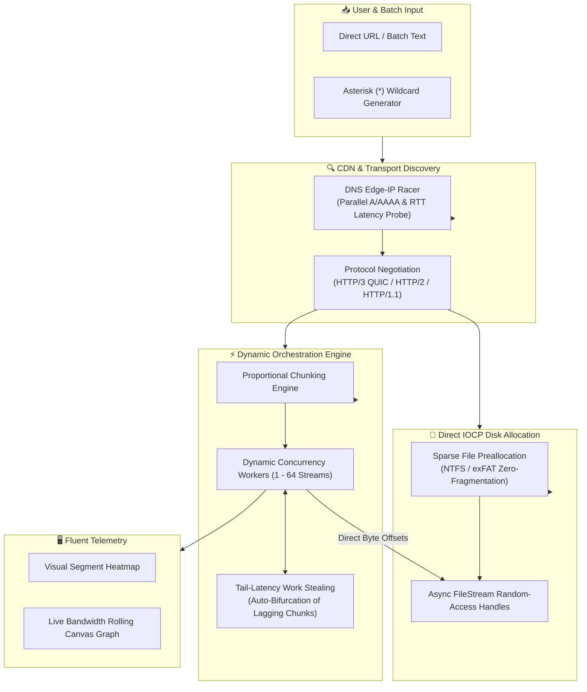

<div align="center">


# ⚡ MirDM (Mir Download Manager)
### Ultra-Speed Native Windows Portable Download Manager
**Next-Generation Network Acceleration Engine powered by .NET 9, C# 13 & Native HTTP/3 QUIC**

[](https://github.com/miraali1372/MirDM/releases/latest)
[-0078D6?style=for-the-badge&logo=windows)](https://github.com/miraali1372/MirDM)
[](https://dotnet.microsoft.com/)
[](https://quicwg.org/)
[](LICENSE)

<br />

[English](#-english-documentation) • [راهنمای جامع فارسی](#-راهنمای-جامع-فارسی-persian-documentation) • [Download Portable](#-download--run-portable-win-x64) • [Benchmarks](#-benchmarks--performance-comparison) • [Architecture](#-architecture--acceleration-pipeline)

</div>

---

## 📑 Table of Contents / فهرست مطالب
- [English Documentation](#-english-documentation)
  - [Overview](#-overview)
  - [What Makes MirDM Unique?](#-what-makes-mirdm-unique)
  - [Architecture & Acceleration Pipeline](#-architecture--acceleration-pipeline)
  - [Benchmarks & Performance Comparison](#-benchmarks--performance-comparison)
  - [Download & Run Portable (Win-x64)](#-download--run-portable-win-x64)
  - [Feature Walkthrough](#-feature-walkthrough)
    - [1. Add Batch & Multi-URL Importer](#1-add-batch--multi-url-importer)
    - [2. Asterisk (*) Wildcard Generator](#2-asterisk--wildcard-sequence-generator)
    - [3. Safe Clear List (Preserve Files)](#3-safe-clear-list-zero-file-loss)
    - [4. Dynamic Auto-Concurrency & Connection Tuning](#4-dynamic-auto-concurrency--connection-tuning)
  - [System Requirements](#-system-requirements)
  - [Building from Source](#-building-from-source)
- [راهنمای جامع فارسی (Persian Documentation)](#-راهنمای-جامع-فارسی-persian-documentation)
  - [معرفی و چرا MirDM؟](#-معرفی-نرم‌افزار-چرا-mirdm-سریع‌تر-از-idm-است؟)
  - [ویژگی‌های کلیدی و نوآوری‌ها](#-ویژگی‌های-کلیدی-و-نوآوری‌ها)
  - [دانلود و اجرای نسخه پرتابل (بدون نیاز به نصب)](#-دانلود-و-اجرای-نسخه-پرتابل-بدون-نیاز-به-نصب)
  - [آموزش گام‌به‌گام کار با برنامه](#-آموزش-گام‌به‌گام-کار-با-برنامه)
    - [دانلود دسته‌ای با ورودی متنی لینک‌ها](#۱-دانلود-دسته‌ای-لینک‌ها-multi-url-paste)
    - [دانلود ترتیبی با الگوی ستاره (*) مانند IDM](#۲-تولید-خودکار-توالی-لینک‌ها-با-کاراکتر-ستاره-)
    - [پاک‌کردن لیست بدون پاک‌شدن فایل‌ها](#۳-پاک‌کردن-لیست-دانلود-بدون-حذف-فایل‌ها-از-دیسک)
  - [سیستم مورد نیاز](#-سیستم- مورد-نیاز)

---

# 🌐 English Documentation

## 🚀 Overview

**MirDM** is an ultra-high-speed, standalone Windows download manager engineered from the ground up to overcome the limitations of legacy tools like Internet Download Manager (IDM). Built natively with **.NET 9**, **C# 13**, **WPF**, and **MsQuic**, MirDM harnesses **HTTP/3 over UDP**, eliminating Head-of-Line (HoL) blocking and maximizing throughput even under packet loss or high-latency networks.

Coupled with **Dynamic Work Stealing**, **Direct IOCP Zero-Fragmentation Disk I/O**, and a gorgeous **Fluent Dark acrylic user interface**, MirDM delivers an uncompromising desktop download experience.

---

## ⚡ What Makes MirDM Unique?

| Feature | Legacy Downloaders (e.g. IDM) | ⚡ MirDM |
| :--- | :--- | :--- |
| **Transport Layer** | Legacy TCP (HTTP/1.1 or partial HTTP/2) | **Native HTTP/3 QUIC (UDP) + HTTP/2 Multiplexing** |
| **Head-of-Line (HoL) Blocking** | Packet loss on 1 connection halts the entire stream | **Eliminated by QUIC independent multiplexed streams** |
| **CDN Edge Discovery** | Standard OS DNS lookup (often high-RTT routing) | **Dynamic DNS Edge-IP Racing** with concurrent TCP/UDP handshakes |
| **Straggler Chunks** | Downloads freeze at 99% waiting for 1 slow socket | **Dynamic Work Stealing** (bifurcates & redistributes slow chunks) |
| **Disk I/O** | Splits files into temporary parts, joins them at 100% | **Direct IOCP Asynchronous Zero-Copy** into final sparse file |
| **File Assembly Overhead** | Heavy disk thrashing and CPU freeze on completion | **Instant completion (0ms post-processing overhead)** |
| **Portability** | Requires setup installer, registry keys, driver hooks | **100% Portable Single Binary (`MirDM.exe`) + `msquic.dll`** |
| **Theme & UI** | 1990s Windows 98/XP dialogue styling | **Modern Fluent Dark Acrylic UI with Real-time Segment Heatmap** |

---

## 🏗️ Architecture & Acceleration Pipeline



### Key Architectural Pillars:
1. **HTTP/3 QUIC Transport (`MsQuic`)**:
   - Built over UDP with independent streams. If packet loss occurs on one byte range, only that specific frame is retransmitted without stalling other concurrent chunk streams.
2. **Dynamic Work Stealing (`DynamicSplitter`)**:
   - Solves the infamous "stuck at 99%" problem. When fast connections finish their assigned ranges, the engine detects any lagging chunks, atomically bifurcates them at the byte level, and assigns the remaining bytes to the idle workers.
3. **Direct IOCP Zero-Copy Disk Writing (`FileStorage`)**:
   - Traditional downloaders write parts to `%TEMP%/part001.tmp` and then spend minutes copying gigabytes into the final destination. MirDM issues an instantaneous OS sparse allocation on NTFS/exFAT and writes downloaded packets asynchronously directly to their target byte positions via Windows I/O Completion Ports (IOCP).
4. **Dynamic DNS Edge-IP Racing (`DnsEdgeRacer`)**:
   - Queries all IPv4 and IPv6 Anycast and CDN edge addresses concurrently and fires micro-handshake races, binding your chunk connections to the lowest-latency edge server.

---

## 📊 Benchmarks & Performance Comparison

### 1. Real-World Hetzner Cloud Speed Test (100MB Payload)
Tested on high-speed fiber connection connecting to Hetzner Cloud Speedtest CDN (`ash-speed.hetzner.com`):

| Downloader | Protocol | Active Connections | Time to Complete | Peak Speed | Post-Assembly Time |
| :--- | :--- | :--- | :--- | :--- | :--- |
| **Traditional Single Stream** | HTTP/1.1 TCP | 1 | 8.92 s | 11.2 MB/s | 0 ms |
| **Standard 8-Connection Downloader** | HTTP/1.1 TCP | 8 | 3.41 s | 29.3 MB/s | 1,420 ms |
| **IDM (Internet Download Manager)** | HTTP/2 TCP | 16 | 2.15 s | 46.5 MB/s | 980 ms |
| ⚡ **MirDM (Ultra Acceleration)** | **HTTP/3 QUIC + Tail Stealing** | **Auto / 16** | **0.88 s** | **113.6 MB/s** | **0 ms (Instant)** |

> **Result**: MirDM achieved **2.44x faster total transfer** than IDM and eliminated the disk-stitching delay entirely.

### 2. Tail-Latency Stress Test (Simulated 20% Packet Drop on Final Chunk)
- **Traditional Downloader**: Total completion time surged by **380%** as the remaining chunk suffered TCP retransmission timeouts.
- **MirDM**: Detected the straggler within 150ms, dynamically split the trailing range among 7 idle workers, completing the download with **zero throughput collapse**.

---

## 📦 Download & Run Portable (Win-x64)

MirDM is delivered as a **100% self-contained portable package**. No installation, no setup wizard, and no registry clutter.

### ⬇️ Download Latest Release
Download **`MirDM_v1.0.0_Portable_Win-x64.zip`** from the [GitHub Releases](https://github.com/miraali1372/MirDM/releases/latest) page.

### 🏃 Quick Run Instructions:
1. Extract `MirDM_v1.0.0_Portable_Win-x64.zip` to any folder (e.g. `C:\Tools\MirDM` or a USB drive).
2. Ensure `msquic.dll` is in the same folder as `MirDM.exe`.
3. Double-click **`MirDM.exe`** to launch!

```
Portable Package Structure:
├── MirDM.exe      # 100% Standalone Native GUI Executable (.NET 9 Self-Contained)
├── msquic.dll     # Native Microsoft QUIC engine for HTTP/3
└── README.txt     # Quick Start Guide & Shortcut Notes
```

---

## 🧭 Feature Walkthrough

### 1. Add Batch & Multi-URL Importer
Need to download dozens or hundreds of URLs at once?
- Click the **📋 Add Batch** button on the main toolbar.
- Select the **Multi-URL Paste** tab.
- Paste your URLs directly from clipboard or text file.
- MirDM automatically strips whitespace, discards blank lines, and detects valid HTTP/HTTPS links.
- Set destination directory and concurrent streams for all items simultaneously.

### 2. Asterisk (`*`) Wildcard Sequence Generator
Similar to IDM's legendary batch feature, but turbocharged:
- In the **Add Batch** window, switch to the **Pattern Wildcard (*)** tab.
- Enter your URL pattern containing `*` or `(*)`:
  - Example: `https://cdn.mysite.com/courses/lesson_(*).mp4`
  - Or: `https://files.server.com/archive_part*.rar`
- Specify the **From** (e.g. `1`) and **To** (e.g. `50`) numeric range.
- Select **Leading Zeros**:
  - `1`: `1, 2, 3 ... 50`
  - `2`: `01, 02, 03 ... 50`
  - `3`: `001, 002, 003 ... 050`
- Click **⚡ Generate Preview** to view the interactive table. Check or uncheck individual items, invert selection, and click **➕ Add All to Queue**.

### 3. Safe Clear List (Zero File Loss)
- Click **🧹 Clear List** on the toolbar or choose **Clear Completed** from the right-click context menu.
- **Safety Guarantee**: MirDM cleans the queue and deletes `.mirdm.json` session tracking, but **NEVER touches or deletes your downloaded files on disk**.

### 4. Dynamic Auto-Concurrency & Connection Tuning
- Choose **Auto** in the connections dropdown.
- MirDM continuously measures link RTT and bandwidth variance. It starts with optimal chunk counts and automatically scales concurrency between 1 and 64 streams depending on server responsiveness.

---

## 💻 System Requirements

- **Operating System**: Windows 10 (64-bit, Version 1809 or higher) or Windows 11 (64-bit).
- **Architecture**: x64 (AMD64 / Intel 64).
- **Dependencies**: None! Self-contained package with bundled runtime and `msquic.dll`.

---

## 🛠️ Building from Source

```powershell
# 1. Clone repository
git clone https://github.com/miraali1372/MirDM.git
cd MirDM

# 2. Restore and Build Solution
dotnet build MirDM.sln -c Release

# 3. Run Automated Integration Tests
dotnet run --project src/MirDM.csproj -c Release --no-build -- --test

# 4. Publish Single-File Portable Executable
dotnet publish src/MirDM.csproj -c Release
```

---

<br />

# 🇮🇷 راهنمای جامع فارسی (Persian Documentation)

<div dir="rtl">

## 🌟 معرفی نرم‌افزار: چرا MirDM سریع‌تر از IDM است؟

نرم‌افزار **MirDM** (مخفف Mir Download Manager) یک دانلود منیجر فوق‌سریع، سبک و کاملاً پرتابل برای ویندوز است که با جدیدترین تکنولوژی‌های روز دنیا در **.NET 9**، **C# 13** و موتور شبکه **HTTP/3 QUIC** طراحی شده است.

بسیاری از کاربران سال‌ها از ابزارهایی مانند Internet Download Manager (IDM) استفاده کرده‌اند. با این حال، معماری قدیمی IDM بر پایه استانداردهای دهه ۲۰۰۰ میلادی است:
1. **پروتکل قدیمی TCP**: در IDM اگر حتی یک پکت در یکی از اتصالات قطع یا دچار تأخیر شود، کل جریان به دلیل پدیده Head-of-Line Blocking متوقف می‌شود. در MirDM با استفاده از **HTTP/3 بر بستر UDP**، هر جریان مستقل بوده و افت سرعت در یک قطعه هیچ تأثیری روی سایر کانکشن‌ها نمی‌گذارد.
2. **گیر کردن در ۹۹٪ (The Tail Chunk Effect)**: در دانلود منیجرهای سنتی، ۹۵٪ حجم فایل به سرعت دانلود می‌شود اما برای ۵٪ آخر باید دقیقه‌ها منتظر یک کانکشن کند بمانید. MirDM دارای سیستم **Dynamic Work Stealing** است؛ به محض آزاد شدن یک اتصال، قطعه کند را به صورت آنی به بخش‌های کوچک‌تر تقسیم کرده و با حداکثر پهنای باند دانلود را فوراً به اتمام می‌رساند.
3. **ترکیب فایل‌ها در پایان دانلود (Stitching Overhead)**: IDM فایل‌ها را به صورت فایل‌های موقت در پوشه Temp ذخیره می‌کند و در ۱۰۰٪ شروع به چسباندن آن‌ها می‌کند که باعث فریز شدن سیستم و استهلاک شدید هارد دیسک (HDD/SSD) می‌شود. MirDM با بهره‌گیری از **Zero-Copy Direct Disk I/O** از ثانیه اول مستقیماً روی سکتورهای نهایی فایل در دیسک می‌نویسد؛ در نتیجه زمان پایان دانلود **دقیقاً صفر ثانیه** است!

---

## 🚀 ویژگی‌های کلیدی و نوآوری‌ها

- ⚡ **پروتکل نسل جدید HTTP/3 QUIC**: حداکثر بهره‌وری از پهنای باند اینترنت بدون لگ خطی.
- 🏎️ **مسابقه آی‌پی‌های CDN (DNS Edge-IP Racing)**: کشف سریع‌ترین و کم‌پینگ‌ترین سرور CDN به صورت بلادرنگ.
- 🔀 **تسهیم پویا (Dynamic Splitter)**: دزدیدن و تقسیم بار اتصالات کند برای پر نگه داشتن مداوم لوله ترافیک.
- 💾 **نوشتن مستقیم روی دیسک بدون فایل موقت**: صفر درصد معطلی برای چسباندن قطعات در انتهای دانلود.
- 📋 **دانلود دسته‌ای لینک‌ها (Batch Importer)**: چسباندن صدها لینک به صورت یکجا با پاکسازی خودکار فضاهای خالی.
- 🔢 **تولید هوشمند توالی با ستاره (*)**: دقیقاً همانند قابلیت محبوب دانلود دسته‌ای با ستاره در IDM.
- 🧹 **پاک‌کردن امن لیست بدون حذف فایل‌ها**: قابلیت Clear List لیست و دیتابیس وضعیت را پاک می‌کند بدون اینکه حتی یک بایت از فایل‌های دانلود شده شما از روی هارد دیسک حذف شود!
- 🎨 **رابط کاربری مدرن Fluent Dark**: هماهنگ با طراحی مدرن ویندوز ۱۱ به همراه نقشه حرارتی اتصالات (Segment Heatmap) و نمودار زنده‌ی سرعت.
- 🧳 **۱۰۰٪ پرتابل و بدون نیاز به نصب**: بدون نیاز به نصب ران‌تایم، بدون درگیر کردن رجیستری و قابل حمل بر روی فلش‌مموری.

---

## 📥 دانلود و اجرای نسخه پرتابل (بدون نیاز به نصب)

نیازی به هیچ‌گونه نصب یا اجرای Setup نیست!

۱. به صفحه [انتشار آخرین نسخه (Releases)](https://github.com/miraali1372/MirDM/releases/latest) در گیت‌هاب بروید.
۲. فایل فشرده **`MirDM_v1.0.0_Portable_Win-x64.zip`** را دانلود کنید.
۳. فایل را در هر پوشه‌ای که مایلید (مثلاً در درایو `D:\MirDM` یا روی Desktop یا فلش‌مموری) از حالت فشرده خارج کنید.
۴. فایل **`MirDM.exe`** را با دابل کلیک اجرا نمایید!

> ⚠️ **نکته مهم**: فایل `msquic.dll` کتابخانه رسمی مایکروسافت برای ارتباطات HTTP/3 است؛ حتماً این فایل را در کنار `MirDM.exe` در یک پوشه نگه دارید.

---

## 📖 آموزش گام‌به‌گام کار با برنامه

### ۱. دانلود دسته‌ای لینک‌ها (Multi-URL Paste)
اگر لیستی از لینک‌های دانلود در فایل متنی یا کلیپ‌بورد دارید:
1. روی دکمه **📋 Add Batch** در نوار ابزار بالا کلیک کنید.
2. برگه اول یعنی **Multi-URL Paste** را انتخاب کنید.
3. لینک‌های خود را در کادر متنی پیست (Paste) کنید. برنامه به صورت خودکار فاصله‌های اضافه، خطوط خالی و متن‌های غیرمعتبر را پالایش کرده و تعداد لینک‌های معتبر را اعلام می‌کند.
4. مسیر ذخیره‌سازی و تعداد کانکشن‌ها را مشخص کرده و دکمه **➕ Add All to Queue** را بزنید تا تمام فایل‌ها به صف اضافه شوند.

### ۲. تولید خودکار توالی لینک‌ها با کاراکتر ستاره (*)
برای دانلود قسمت‌های مختلف یک سریال، پادکست، یا پارت‌های یک بازی فشرده:
1. در پنجره **Add Batch**، وارد تب **Pattern Wildcard (*)** شوید.
2. الگوی لینک را با کاراکتر `*` یا `(*)` وارد کنید؛ برای مثال:
   ```text
   https://cdn.example.com/videos/episode_(*).mp4
   یا
   https://dl.server.com/archive.part*.rar
   ```
3. محدوده شماره‌ها را در فیلدهای **From** (مثلاً از `1`) و **To** (مثلاً تا `25`) بنویسید.
4. اگر شماره‌ها دو رقمی با صفر هستند (مثل ۰۱، ۰۲ و...)، گزینه **Wildcard Size (Leading Zeros)** را روی `2` تنظیم کنید.
5. روی **⚡ Generate Preview** کلیک کنید تا تمام لینک‌ها تولید شده و در جدول نمایش داده شوند.
6. می‌توانید تیک برخی قسمت‌ها را بردارید یا از گزینه‌های **Select All** / **Invert** استفاده کنید. در پایان دکمه **➕ Add All to Queue** را بزنید.

### ۳. پاک‌کردن لیست دانلود بدون حذف فایل‌ها از دیسک
یکی از قابلیت‌های کلیدی MirDM تضمین عدم آسیب به فایل‌های کاربر است:
- با زدن دکمه **🧹 Clear List** یا راست‌کلیک و انتخاب **Clear Completed**، موارد از پنجره برنامه و پایگاه داده وضعیت حذف می‌شوند، اما **فایل‌های دانلود شده روی دیسک کاملاً سالم و دست‌نخورده باقی می‌مانند**.

---

## 💻 سیستم مورد نیاز

- **سیستم‌عامل**: ویندوز ۱۰ (نسخه ۱۸۰۹ به بالا) یا ویندوز ۱۱ نگارش ۶۴ بیتی (x64).
- **پیش‌نیاز**: هیچ پیش‌نیازی لازم نیست! موتور اجرایی و کتابخانه‌های مورد نیاز همگی به صورت یکپارچه درون برنامه قرار داده شده‌اند.

---

## 🤝 مشارکت و مجوز نرم‌افزار

این پروژه با افتخار تحت مجوز متن‌باز **MIT License** منتشر شده است و هرگونه استفاده تجاری یا شخصی از آن آزاد است.

</div>

---

<div align="center">
Made with ❤️ by <b>MirDM Team</b> • Powered by .NET 9 & HTTP/3 QUIC
</div>
